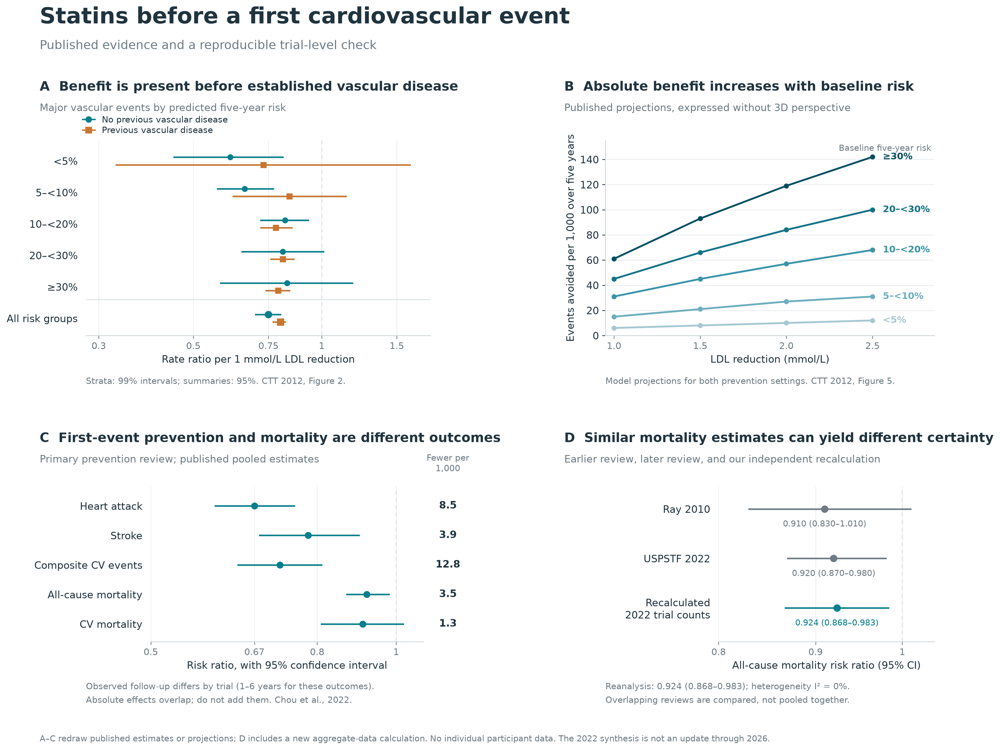

# Statins in primary prevention

A reproducible exploration of statins **before a first cardiovascular event**:
what the randomized evidence shows, how absolute benefit depends on baseline
risk, and why reviews can reach different conclusions about mortality.

The project combines a source collection, redrawn published figures, and an
independent meta-analysis of published trial counts. Start with the overview
below, then open the [notebook](analysis/statins_overview.ipynb) to
follow the calculations or the [research overview](OVERVIEW.md) for the broader
historical and clinical context.

## Evidence at a glance

[](figures/statins_overview.pdf)

[Open the full-size PNG](figures/statins_overview.png) ·
[Download the PDF](figures/statins_overview.pdf) ·
[Editable SVG](figures/statins_overview.svg)

The figure separates four questions that are easily conflated: whether statins
prevent cardiovascular events, how many events are prevented, which outcome is
being measured, and how precisely mortality effects are estimated.

### A — Benefit before established vascular disease

The forest plot compares published CTT estimates for people with and without
previous vascular disease, grouped by predicted five-year cardiovascular risk.
The horizontal axis is the **rate ratio per 1 mmol/L reduction in LDL cholesterol**;
values below 1 indicate fewer major vascular events. The pooled result in people
without previous vascular disease supports benefit before an event has occurred.
Risk-stratum intervals are **99% confidence intervals**; the overall summaries use
**95%**. Wider intervals in individual strata show uncertainty about the size of
the effect. [Source: CTT 2012, Figure 2](https://pmc.ncbi.nlm.nih.gov/articles/PMC3437972/)

### B — Absolute benefit depends on baseline risk

The same relative reduction can prevent more events in a higher-risk population.
This panel redraws published projections of **events avoided per 1,000 people
over five years**, by baseline risk and LDL reduction. These are model outputs
covering both prevention settings, not observed event counts or a new regression.
Lines connect the published projection values.
[Source: CTT 2012, Figure 5](https://pmc.ncbi.nlm.nih.gov/articles/PMC3437972/)

### C — Preventing an event and reducing mortality are different outcomes

The 2022 USPSTF review reports separate estimates for heart attacks, strokes,
composite cardiovascular events, all-cause mortality, and cardiovascular mortality.
For example, its pooled all-cause mortality estimate is **RR 0.92 (95% CI
0.87–0.98)**, with an absolute difference of **3.5 fewer deaths per 1,000** over the
included trials' follow-up. The absolute effects are not standardized five-year
predictions. Outcomes overlap and must not be added together; a composite
cardiovascular outcome is not interchangeable with mortality.
[Source: Chou et al. 2022](https://doi.org/10.1001/jama.2022.12138)

### D — Similar mortality estimates can have different precision

The earlier Ray review and the 2022 USPSTF review have similar mortality point
estimates, while their confidence intervals differ in whether they cross 1.
Our recalculation from the 2022 review's printed trial counts gives **RR 0.924
(95% CI 0.868–0.983)**, reproducing its published result after rounding. It uses
inverse-variance random effects with the DerSimonian–Laird method and normal
95% confidence intervals. Seventeen estimates contribute from 18 trial rows;
one trial had no deaths in either arm.

The reviews contain overlapping trials and are compared rather than pooled
together. An interval crossing 1 indicates uncertainty; it does not establish
that there is no benefit. The notebook also shows how the mortality estimate
changes when individual trials are omitted.
[Ray et al. 2010](https://doi.org/10.1001/archinternmed.2010.182),
[recalculation and methods](analysis/README.md#what-was-recalculated)

## Scope and interpretation

Panels **A–C redraw published estimates or projections**. Panel **D includes our
own aggregate-data calculation**. No individual participant data were available,
and CTT's participant-level models have not been independently refitted here.
The calculations reconstruct selected results from the **2022 review**, rather
than a systematic review updated through 2026.

The overview focuses on benefits and mortality. The notebook's separate
[harms figure](figures/harms_context.png) discusses muscle
symptoms and diabetes. Its annual harm rates cannot simply be subtracted from
five-year benefit projections with different populations and time horizons.
See the [analysis guide](analysis/README.md) for extraction decisions, sensitivity
analyses, provenance, and limitations.

## Reproduce the figures

Git contains the analysis code, hand-curated source catalog and evidence tables,
and a notebook with its execution outputs cleared. Downloaded papers, extracted
text, generated CSVs, indexes, and analysis exports stay local. The four figure
assets linked above are retained in `figures/` so the README displays on GitHub.

From the project root, install the pinned analysis and notebook packages, plus
the source-retrieval packages:

```bash
python3 -m venv .venv
.venv/bin/python -m pip install -r analysis/requirements-notebook.txt requests beautifulsoup4
```

Install the system Poppler tools (`pdftotext`, `pdfseparate`, and `pdftoppm`), then
retrieve the public sources and rebuild the derived files:

```bash
.venv/bin/python scripts/download_sources.py
.venv/bin/python scripts/enrich_sources.py
.venv/bin/python scripts/add_public_copies.py
.venv/bin/python scripts/build_index.py
.venv/bin/python scripts/collect_figures.py
.venv/bin/python analysis/extract_data.py
.venv/bin/python analysis/test_analysis.py
.venv/bin/python analysis/run_analysis.py
```

Source retrieval requires network access. URLs and access restrictions can change;
if a required source cannot be retrieved, obtain the cited original separately
and put it at the path expected by the extraction script. The seven originals
required for extraction are listed in `analysis/extract_data.py`.

The analysis script writes figures and tables to `analysis/output/`. Open
[analysis/statins_overview.ipynb](analysis/statins_overview.ipynb), select the
`.venv` Python kernel, and run all cells for the notebook walkthrough. Once the
inputs have been extracted, running the notebook needs no source downloads;
its exports go to `analysis/notebook_output/`.

To refresh the README assets after rerunning the notebook:

```bash
cp analysis/notebook_output/statins_overview.{png,pdf,svg} figures/
cp analysis/notebook_output/harms_context.png figures/
```

Clear the notebook's cell outputs before staging it. Generated files remain
ignored; only the explicit README figure assets are versioned.

## Repository guide

Use the [source catalog](data/sources.json) for canonical paper links and the
[research overview](OVERVIEW.md) for the wider evidence discussion. The scripts
rebuild the detailed study index, bibliography, and download-status tables locally.

| File or folder | Contents |
| --- | --- |
| [OVERVIEW.md](OVERVIEW.md) | Findings, historical origins, trial comparisons, harms, guidelines, and statistical explanation |
| [figures/README.md](figures/README.md) | Original figures in suggested reading order, with explanations and interpretation limits |
| [analysis/README.md](analysis/README.md) | Extracted figure data, a new overview figure, replicated meta-analyses, sensitivity checks and code |
| [analysis/statins_overview.ipynb](analysis/statins_overview.ipynb) | Notebook source with figure generation, explanations, data sources and reproducible calculations |
| [data/sources.json](data/sources.json) | Maintained source catalog with canonical links and retrieval settings |
| `papers/` and `text/` (generated locally) | Downloaded sources and searchable text |
| [data/trial_results.csv](data/trial_results.csv) | Selected trial outcomes with populations, follow-up, and limitations |
| [data/review_results.csv](data/review_results.csv) | Review estimates, preserving effect measures and time horizons |
| `STUDY_INDEX.md`, `references.bib`, and `data/source_index.csv` (generated locally) | Detailed source index, bibliography, and spreadsheet inventory |
| `data/download_manifest.json` (generated locally) | Download provenance, failures, sizes, and checksums |
| [notes/METHODS.md](notes/METHODS.md) | Search scope, extraction decisions, limitations, and reproduction instructions |
| [scripts/](scripts/) | Source retrieval and index generation |

The two generated statistical example CSVs in `data/` contain **invented illustrations**, not study observations. The original 2013 BMJ PDF contains adverse-effect claims corrected in 2014; its correction is linked in the overview and generated source index.
